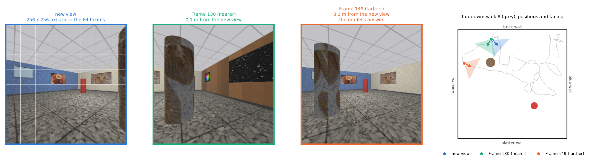

# Localizing without a full place code

*Novel-view behavior and heading invariance in vision-language models*

**Do neurons in a vision-language model act like hippocampal place cells when the model watches a
first-person walk through a room? And can the model tell where a new view was taken, when it faces
a way it never faced from that spot?**



*One trial. After a 256-frame walk through a 10 m room, the model sees a new view (left) and is
asked whether it was taken nearer Frame 130 or Frame 149. Frame 130 is 0.1 m away but faces
another way. Qwen3.8-27B picks Frame 149, 3.3 m away, which shows the same posters.*

This project applies rodent-style single-unit analysis (rate maps, spatial information, gridness,
heading invariance, all against shuffle nulls), population tests, linear probes, behavioral tests
and causal interventions (activation patching, attention cuts, re-rendering the frames a model is
shown) to Qwen3-VL 2B/8B/32B, Qwen3.8-27B, Qwen3.6-35B-A3B, Gemma 4, SenseNova-SI, DINOv2, the 3D
pose model VGGT, and, through their APIs, Claude Haiku, Sonnet and Opus 5.5, GPT-6 Astra, Kimi K3
and DeepSeek V4.1 Flash. Most experiments run in ray-cast rooms, where every frame's true position
and heading are known; 34 photoreal Replica and HSSD scenes are rendered with Habitat. Each
experiment's rule and results are in [docs/experiments.md](docs/experiments.md), and the paper's
Registration appendix lists when each rule was logged and first committed publicly.

## Key findings

Accuracies are on novel-view trials unless stated; chance is 50%.

1. **Units that pass rodent place-cell criteria are everywhere, so on their own they mean little.**
   Raw pixels produce 72% place units and random-weight networks 61-81%. What separates a place
   code from a view code is heading invariance. We call a place unit strictly invariant when its
   rate maps agree (correlation above 0.5) across all six pairs of 90° heading sectors.
   Path-integrating RNNs pass at 97-100%, which validates the test, whereas VLM units on single
   frames pass at no more than 0.3%. With the walk in context the share rises to 2-29%, but a moving
   average of single-frame activations does better (82-88%), so that rise needs nothing beyond
   temporal smoothing.
2. **At the inputs we tested, open VLMs pick the frame that looks right.** The base Qwen3-VL-8B stays
   at chance across ten held-out rooms (52%). On trials where only the far frame shares a landmark
   with the new view, removing that landmark changes only 4 of 38 answers. Neither scale nor a
   published spatial fine-tune fixes this.
3. **A small fine-tuned model solves the task in procedural rooms.** LoRA on 1,136 procedural rooms
   (about 0.5% of the weights, answer-only loss) with a four-epoch recipe reaches 97.1% across ten
   held-out rooms (96.3-97.4% over five runs; an earlier two-epoch schedule was unreliable, at
   69-93%).
   - It beats all 149 retrieval rules we tested, the highest of which reaches 67.7%, by at least
     26.0 points in every difficulty bin. A trained sequence matcher reaches 73.3%.
   - It depends on the walk's order: ordered beats shuffled by 15.1-42.9 points, depending on the run.
   - It holds on walks unlike the training walks (95.5-97.5%, 27.8-31.2 points above retrieval).
4. **The photoreal scenes do not settle the question.** The four-epoch mean is 94.4% across all 34
   scenes on all trials. But on the novel trials of the first 11 scenes, it reaches 88.1% against
   74.9% for retrieval, a lead of 13.2 points [5.6, 19.4]. That is under the 15-point margin we
   require, so these scenes do not separate localization from retrieval.
5. **The fine-tuned model's units fall short of a place code.** With the walk at layer 35, 8-17% of
   its place units pass the strict test (18-31% on a weaker mean of two sector pairs), which is an
   undercount at that layer's stability. Within a room, its population carries position across
   headings on walk frames (heading-held-out gain 0.77-0.85; RNNs 0.98), and partly for the new view
   (0.39-0.49). That late-layer walk code depends on order: on shuffled walks the gain falls to
   0.28-0.35. No position code carries across rooms.
6. **The decision depends more on where frames were taken than on what they show.** When we
   re-render the eight shown frames around the near option, changing the place costs 21.1-22.4
   points and changing the view 5.2-5.6 (runs 5 and 7). Moving a block of frames away from both
   options, or moving the far option's frames elsewhere, costs about nothing, while moving the far
   option's frames next to the new view pulls the decision by 10.2-11.1 points. The pull is partial:
   accuracy stays at 87.9% and 86.6%.
7. **Claude Opus 5.5 gains from the walk but is not clearly above retrieval in the procedural
   rooms.** It gains 9.7 points [7.0, 12.1] in the ten held-out rooms and 28.0 [26.2, 30.5] in eight
   HSSD houses. In the held-out rooms it reaches 72.9%, which is 5.2 points [-0.3, 10.9] above
   retrieval. Matched on frames, order, labels and question, the fine-tuned model leads it by 18.6
   points [16.6, 20.8]. GPT-6 Astra also gains from the walk in room A; Kimi K3, DeepSeek V4.1 Flash
   and the open models we could screen do not. API replies are scored by the answer they state
   (`spatialcells/answers.py`; see "Scoring correction" in the experiment notes).
8. **VGGT, the positive control, has a causal pose code.** Its heading invariance is intermediate
   (34% of place units on single frames with anchors). Copying the camera token's ten main
   directions from one frame to another at block 21 moves the reported position 0.86 of the way to
   the donor. These come from ordinary PCA with no position labels; a position-labeled subspace
   gives 0.85 and overlaps them 0.85, and no 2-d subspace we tested comes close. Heading and camera-frame parts are both needed and split the head's outputs.
9. **The result rests on one model family.** The same recipe on Gemma 4 12B did not meet the bar in
   three runs (54.7-81.3% on held-out validation rooms).
10. **The grid-cell scorer works, and no model has grid cells.** A path-integrating RNN trained
    following Sorscher et al. grows hexagonal grids, and the unchanged pipeline flags 93% of the
    strong ones. No grids with spacing of 2 m or more appear in pixels, DINOv2, Qwen or VGGT.

## Results at a glance

Novel-view trials, with the walk. Lure-free trials; chance 50%.

| | ten held-out procedural rooms | 11 photoreal scenes |
|---|---|---|
| Qwen3-VL-8B + LoRA, four-epoch mean (64-frame walk) | **97.1%** | **88.1%** |
| The same, on Opus's 256-frame walk | 91.4% | not run |
| Claude Opus 5.5 (256-frame walk) | 72.9% | 85.0% |
| Trained sequence matcher | 73.3% | 47.8% |
| Highest of 149 retrieval rules, on these trials | 67.7% | 74.9% |

The full write-up, with methods, controls, caveats and per-experiment commands, is in
**[docs/experiments.md](docs/experiments.md)**.

## Repository layout

```
spatialcells/            the package (run modules with python -m spatialcells.<module>)
  room.py                ray-cast 10 m room, procedural layouts, foraging walks
  render_data.py         render walks -> data/walks
  render_probes.py       teleport probes (views from visited places, random headings)
  procedural_data.py     1,200 procedural rooms and trials for fine-tuning
  habitat_scene.py       photoreal Replica and HSSD scenes through Habitat
  extract.py             record MLP neurons of DINOv2 / Qwen models along the walks
  analyze.py             place, grid and head-direction scoring, heading invariance, decoding
  analyze_probes.py      teleport-probe decoding across headings
  summarize.py           summary figures and tables
  behave.py, behave_reason.py, analyze_behave.py      "where am I?" behavior tests
  dissimilar_trials.py   the lure-free trial set
  two_choice.py          two-choice test for any Hugging Face VLM (optionally a LoRA adapter)
  claude_test.py         the same test through the Anthropic API; api_test.py for other providers
  answers.py             the answer a free-text API reply states
  std_bench.py           VSI-Bench and MindCube
  task_record.py, task_probe.py, e4_internals.py      the fine-tuned model recorded during the task
  lure_edit.py           lure trials re-rendered without the shared landmark
  trajectory_shift.py    walks unlike the training walks
  vlm_intervention.py    re-rendering the frames a model is shown, and its broken-walk control
  vggt_*.py              VGGT control, unit recording, patching, remapping, anchors, steering
  grid_rnn.py            grid-cell positive control (Sorscher-style RNN, synthetic grids)
  finetune.py, ft_seeds.py, adjacency_baseline.py     LoRA fine-tuning and its baselines
scripts/                 the exact job scripts and analyses behind each experiment
  retrieval_baselines.py, learned_matcher.py, population_assay.py, heading_stat_validation.py
  vggt_subspace_controls.py, vggt_pair_patch.py, vggt_token_pca.py
  vast1/, rtx4070/, mac/ helpers for the GPU hosts and Apple silicon (docs/gpu_host.md)
results/                 summaries (JSON/CSV), per-trial answers (JSONL) and figures
  export/dissimilar/     the 192 lure-free trials (probes + trials.json)
docs/experiments.md      full write-up of experiments 1-32, with their rules
```

## Reproducing

```bash
git clone https://github.com/molinzhao27/vlm-place-cells.git
cd vlm-place-cells
pip install -e .              # CPU: room, rendering, scoring, baselines
pip install -e ".[gpu]"       # + VLM extraction, behavior tests, VGGT, LoRA (CUDA or Apple silicon)
pip install -e ".[claude]"    # + the Claude API test
```

All paths are relative to the repository root. Generated data (rendered walks, activations,
checkpoints) goes to `data/`, which is not tracked.

```bash
python -m spatialcells.render_data                  # 48 walks x 256 frames -> data/walks (CPU)
python -m spatialcells.render_probes                # teleport probes
python -m spatialcells.analyze --tags pixels        # place/grid/HD scores for the raw-pixel baseline
python -m spatialcells.grid_rnn --synthetic         # gridness scorer on synthetic grid cells (CPU)
```

Each experiment in [docs/experiments.md](docs/experiments.md) ends with the commands that
produced it. The GPU experiments ran on a 96 GB RTX PRO 6000, a 32 GB RTX 5090, a 12 GB RTX 4070
(VGGT, Habitat) and Apple silicon (`--device mps`); `scripts/` holds the job scripts, and
[docs/gpu_host.md](docs/gpu_host.md) describes the remote setup. The VGGT experiments also need the
[VGGT repository](https://github.com/facebookresearch/vggt) cloned.

## Data and adapters

- Walk frames, the training rooms and every model's per-trial answer:
  [molinzhao/vlm-place-cells](https://huggingface.co/datasets/molinzhao/vlm-place-cells).
- LoRA adapters (runs 0-2, the GPU control and the four-epoch runs 3-7):
  [molinzhao/vlm-place-cells-lora](https://huggingface.co/molinzhao/vlm-place-cells-lora).

The Hugging Face repositories open when the preprint is posted. The photoreal renders are not
redistributed because of the Replica and HSSD licenses; their trial lists and the render scripts are
included.

## Citation

A preprint is in preparation. Until then:

```bibtex
@misc{zhao2026localizing,
  title  = {Localizing without a full place code: novel-view behavior and heading invariance in
            vision-language models},
  author = {Zhao, Molin},
  year   = {2026},
  url    = {https://github.com/molinzhao27/vlm-place-cells}
}
```

## License

Code: [MIT](LICENSE). Figures and trial data in `results/`: CC BY 4.0.
