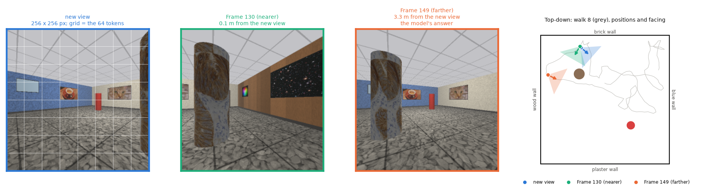
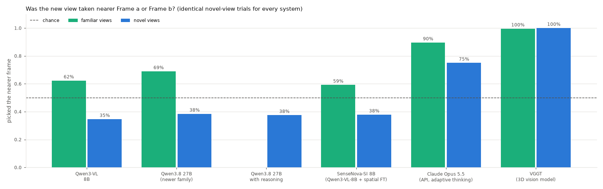

# Recognising views, not places

**Do neurons in a vision-language model act like hippocampal place cells when the model watches a
first-person walk through a room? And can the model tell where a new view was taken, when it faces
a way it never faced from that spot?**



*One trial. After a 256-frame walk through a 10 m room, the model sees a new view (left) and is
asked whether it was taken nearer Frame 130 or Frame 149. Frame 130 is 0.1 m away but faces
another way. Qwen3.8-27B picks Frame 149, 3.3 m away, which shows the same posters.*

This project applies rodent-style single-unit analysis (rate maps, spatial information, gridness,
heading invariance, all against shuffle nulls), linear probes, behavioural tests and causal
interventions (activation patching, erasure, steering, attention cuts) to Qwen3-VL 2B/8B/32B,
Qwen3.8-27B, Qwen3.6-35B-A3B, Gemma-4-31B, SenseNova-SI, DINOv2, the 3D pose model VGGT, and Claude
Haiku, Sonnet and Opus 5.5, Kimi K3 and DeepSeek V4.1 Flash (through their APIs). Most experiments
run in ray-cast rooms, where every frame's true position and heading are known; one test uses three
photoreal Replica apartments rendered with Habitat. Experiments 10-15 were pre-registered in
[docs/experiments.md](docs/experiments.md) before any model saw their data.

## Key findings

1. **Units that pass rodent place-cell criteria are everywhere, so on their own they mean little.**
   72% of raw pixels, 20-63% of DINOv2 units (trained or random) and 29-37% of Qwen3-VL-2B units
   pass. What separates a place code from a view code is heading invariance, tested strictly by
   comparing rate maps built from opposite 90° heading sectors. Path-integrating RNNs pass this test
   with 98-100% of their place units, which validates it, whereas VLM units on single frames pass at
   0-1%. With the walk in context the share rises to 7-51%, but a moving average of single-frame
   activations reproduces that rise (90-94%), so it needs nothing beyond temporal smoothing.
   ([Exp 1](docs/experiments.md#experiment-1-spatial-cells-pilot-spatialcells), Exp 13e-f)
2. **Open VLMs recognise views, not places.** Qwen models from 2B to 32B cannot place a view seen
   from a new direction: teleport probes decode at chance across headings (3.2-3.5 m; chance
   3.6 m), and in their answers at most 3% of novel views are placed within 1 m. In the two-choice
   test they tend to pick the frame that looks more like the new view. On the trials where only the
   far frame shares a landmark with it, removing that landmark changes only 4 of the base 8B model's
   38 answers, because the far frame still looks more similar overall (DINOv2 favours it on 66% of
   those trials). The walk does not help any open model, and neither does scale, a published
   spatial fine-tune or reasoning. ([Exp 2-3](docs/experiments.md#experiment-2-teleport-probes-across-model-sizes),
   [Exp 5](docs/experiments.md#experiment-5-why-do-open-models-fail-and-does-any-pass), Exp 14c)
3. **A small model can learn the skill, without learning places.** LoRA on 1,136 procedural rooms
   (about 0.5% of the weights, answer-only loss) takes Qwen3-VL-8B from 50% to 92% on room A's
   novel trials and to 92.5% across ten pre-registered held-out rooms (base 52%; better in 10/10
   rooms). It transfers to the photoreal apartments (86.7% vs base 55.1%). It needs the walk in
   order, and the order controls say how it uses it: renumbering the frames costs nothing, shuffling
   8-frame blocks keeps 74% of the order effect, and reversing the walk costs 25 points. Yet only 14%
   of its place units are strictly heading-invariant (base 7%), its decision becomes readable in the
   residual stream between layers 18 and 20, and the new view's position does not decode across
   rooms in either model. ([Exp 9](docs/experiments.md#experiment-9-teaching-a-small-model-the-skill),
   Exp 10, 12, 13a, 14a)
4. **Claude Opus 5.5 gains a little from the walk in procedural rooms and a lot in apartments.**
   Across the ten held-out rooms its walk gain is 6.4 points [4.1, 8.2] (9/10 rooms), and the
   fine-tuned 8B beats it by 23 points; in the three apartments the gain is 28 points (84.1% vs
   55.7%), matching the fine-tuned model's accuracy, and a shuffled walk does as well as an ordered
   one there. The apartments may also help by letting the walk group views into rooms. Kimi K3 and
   DeepSeek V4.1 Flash gain nothing from the walk.
   ([Exp 5-6](docs/experiments.md#experiment-6-does-opus-follow-the-path-shuffled-walk), Exp 10-12, 14b)
5. **VGGT, the positive control, has a causal position code.** With reference views it places 98%
   of novel views within 1 m. Its heading invariance is intermediate: 45% of its block-19 place
   units are strictly invariant on one frame with anchors, between the VLMs and the RNNs. Activation
   patching finds a 10-dimensional residual-stream subspace that carries the position its camera
   head reports: copying it moves the output 0.85 of the way to the donor at block 21, fit in one
   room it works as well in another (0.87), patching its exact complement does nothing, and erasing a
   random 10-d subspace leaves the camera error unchanged. No 2-d subspace comes near, including
   probe directions with R² 0.99. Its place maps rotate with the anchor views: after the anchors
   are rotated by 45°, 96% of place units' maps match the original maps turned by 45° better than
   the unturned ones (median correlation 0.95). So they code position in the anchors' frame, which
   is why they look the same in two rooms with anchors at the same poses. Setting or steering the place
   *neurons* barely moves the camera.
   ([Exp 4](docs/experiments.md#experiment-4-does-a-model-that-knows-where-it-is-have-place-cells-vggt),
   [Exp 8](docs/experiments.md#experiment-8-can-we-steer-vggts-place-neurons), Exp 13c, 14d-e)
6. **The grid-cell scorer works, and no model has grid cells.** A path-integrating RNN trained
   following Sorscher et al. grows hexagonal grids, and the unchanged pipeline flags 93% of the
   strong ones. No grids with spacing of 2 m or more appear in pixels, DINOv2, Qwen or VGGT.
   ([Exp 7](docs/experiments.md#experiment-7-can-our-scorer-find-a-grid-cell-at-all-positive-control))

## Results at a glance

Two-choice test, room A, lure-free novel-view trials (102 trials; chance 50%; walk = the 256-frame
walk in context; Claude models at high effort):

| | no walk | with walk |
|---|---|---|
| Qwen3-VL-8B | 59% (71% at 512 px) | 50% |
| Qwen3.8-27B, thinking | 61% (63% at 512 px) | 65% |
| Gemma-4-31B | 56% (68% at 1024 px) | 53% |
| Claude Haiku 5.5 | 67% | 56% |
| Claude Sonnet 5.5 | 64% | 70% |
| Claude Opus 5.5 | 63% | 75% |
| Qwen3-VL-8B + LoRA on procedural rooms (64-frame walk) | 53% | **92%** |

None of the open models' walk-minus-no-walk differences is significant. Pre-registered tests in new
rooms (novel trials for the procedural rooms, all lure-free trials for the apartments):

| | ten held-out procedural rooms | three Replica apartments |
|---|---|---|
| Qwen3-VL-8B, with walk | 52% | 55.1% |
| Qwen3-VL-8B + LoRA, with walk / shuffled | 92.5% / 51.3% | 86.7% / 53.5% |
| Claude Opus 5.5 (low effort), walk gain | +6.4 points | +28.4 points |
| VGGT | | 82.3% |

On the original trials, which contain the landmark lures, every open model falls below chance and
VGGT gets all 104 right:



The full write-up, with methods, controls, caveats, amendments and per-experiment commands, is in
**[docs/experiments.md](docs/experiments.md)**.

## Repository layout

```
spatialcells/            the package (run modules with python -m spatialcells.<module>)
  room.py                ray-cast 10 m room, procedural layouts, foraging walks
  render_data.py         render walks -> data/walks
  render_probes.py       teleport probes (views from visited places, random headings)
  procedural_data.py     1,200 procedural rooms and trials for fine-tuning
  extract.py             record MLP neurons of DINOv2 / Qwen models along the walks
  analyze.py             place, grid and head-direction scoring, heading invariance, decoding
  analyze_probes.py      teleport-probe decoding across headings
  summarize.py           summary figures and tables
  behave.py, behave_reason.py, analyze_behave.py      "where am I?" behaviour tests
  dissimilar_trials.py   the lure-free trial set
  two_choice.py          two-choice test for any Hugging Face VLM (optionally a LoRA adapter)
  claude_test.py         the same test through the Anthropic API; api_test.py for other providers
  task_record.py, task_probe.py   the fine-tuned model recorded during the task (Exp 14a)
  lure_edit.py           lure trials re-rendered without the shared landmark (Exp 14c)
  vggt_*.py              VGGT control, unit recording, patching, remapping, anchors, steering
  grid_rnn.py            grid-cell positive control (Sorscher-style RNN, synthetic grids)
  finetune.py, ft_seeds.py, adjacency_baseline.py     LoRA fine-tuning and its baselines
scripts/                 the exact job scripts and analyses behind each experiment
  vast1/, rtx4070/, mac/ helpers for the GPU hosts and Apple silicon (docs/gpu_host.md)
results/                 summaries (JSON/CSV), per-trial answers (JSONL) and figures
  export/dissimilar/     the 192 lure-free trials (probes + trials.json)
docs/experiments.md      full write-up of experiments 1-15, with pre-registrations
```

## Reproducing

```bash
git clone https://github.com/molinzhao27/vlm-place-cells.git
cd vlm-place-cells
pip install -e .              # CPU: room, rendering, scoring, baselines
pip install -e ".[gpu]"       # + VLM extraction, behaviour tests, VGGT, LoRA (CUDA or Apple silicon)
pip install -e ".[claude]"    # + the Claude API test
```

All paths are relative to the repository root. Generated data (rendered walks, activations,
checkpoints) goes to `data/`, which is not tracked.

```bash
python -m spatialcells.render_data                  # 48 walks x 256 frames -> data/walks (CPU)
python -m spatialcells.render_probes                # teleport probes
python -m spatialcells.analyze --tags pixels        # place/grid/HD scores for the raw-pixel baseline
python -m spatialcells.grid_rnn --synthetic         # gridness scorer on synthetic grid cells (CPU)
```

Each experiment in [docs/experiments.md](docs/experiments.md) ends with the commands that
produced it. The GPU experiments ran on a 96 GB RTX PRO 6000, a 12 GB RTX 4070 (VGGT, Habitat)
and Apple silicon (`--device mps`, which reproduced the CUDA answers trial for trial where both
were run); `scripts/` holds the job scripts, and [docs/gpu_host.md](docs/gpu_host.md) describes
the remote setup. The VGGT experiments also need the
[VGGT repository](https://github.com/facebookresearch/vggt) cloned.

Not tracked, because of size: the walk frames used by the Claude test
(`results/export/claude/`, 90 MB), raw generation records (`results/behave/qwen38-reason.npz`)
and per-layer rate-map figures (`results/figs/`). They will be archived with the preprint.

## Citation

A preprint is in preparation. Until then:

```bibtex
@misc{zhao2026views,
  title  = {Recognising views, not places: novel-view localisation and heading invariance in
            vision-language models},
  author = {Zhao, Molin},
  year   = {2026},
  url    = {https://github.com/molinzhao27/vlm-place-cells}
}
```

## License

Code: [MIT](LICENSE). Figures and trial data in `results/`: CC BY 4.0.
